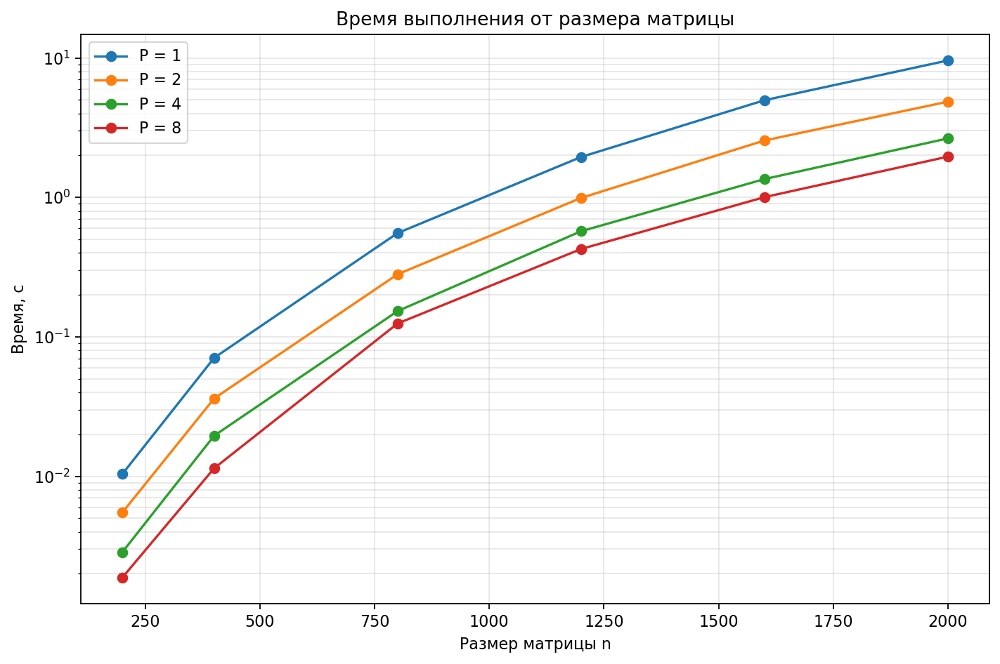

# Отчёт по лабораторной работе №3
## Параллельное умножение квадратных матриц с использованием MPI

---

## Цель работы

Реализовать параллельный алгоритм умножения двух квадратных матриц `C = A · B` размера `n × n` с использованием технологии MPI и исследовать его производительность в зависимости от числа процессов и размера матрицы.

---

## Постановка задачи

Даны две квадратные матрицы `A` и `B` размера `n × n` с целочисленными элементами (тип `long long`). Требуется вычислить матрицу `C = A · B`.

---

## Алгоритм

Реализован **параллельный алгоритм умножения с разбиением по строкам матрицы `A`**:

1. Ранг 0 читает матрицы `A` и `B`, проверяет совпадение размеров, рассылает `n` всем процессам (`MPI_Bcast`).
2. Матрица `B` целиком рассылается всем процессам (`MPI_Bcast`).
3. Строки `A` распределяются между процессами как можно более равномерно (`MPI_Scatterv`): процесс с индексом `r` получает `n/P + (r < n mod P ? 1 : 0)` строк.
4. Каждый процесс вычисляет свой блок строк: `C_local = A_local · B`.
5. Локальные блоки собираются на ранге 0 (`MPI_Gatherv`), результат записывается в файл.

**Внутреннее ядро умножения** (`multiply`) использует порядок циклов `i–k–j` — кэш-дружественный вариант: внутренний цикл идёт по непрерывному участку памяти `C` и `B`, что даёт лучшую локальность по сравнению с наивным `i–j–k`.

**Замер времени** охватывает только параллельную часть.

---

## Методика эксперимента

- **Размеры матриц:** `n ∈ {200, 400, 800, 1200, 1600, 2000}`.
- **Число процессов:** `P ∈ {1, 2, 4, 8}`.
- **Повторы:** по 3 прогона для каждой пары `(n, P)`; в таблицах — средние.
- **Метрики:**
  - `time_s` — время параллельной части, с;
  - `ops = 2n³` — арифметических операций типа mul+add;
  - `gops = ops / time · 10⁻⁹` — производительность, GFLOP/s.

Соглашение `ops = 2n³` — стандартное: `n²` элементов результата × `n` пар «умножить + сложить» = `2n³` операций.

---

## Результаты

### Среднее время выполнения, с

|    n |     P=1 |     P=2 |     P=4 |     P=8 |
| ---: | ------: | ------: | ------: | ------: |
|  200 | 0,01040 | 0,00551 | 0,00286 | 0,00188 |
|  400 | 0,07071 | 0,03616 | 0,01954 | 0,01141 |
|  800 | 0,55476 | 0,28099 | 0,15303 | 0,12463 |
| 1200 | 1,94868 | 0,99102 | 0,57183 | 0,42637 |
| 1600 | 4,97657 | 2,55931 | 1,35323 | 1,00450 |
| 2000 | 9,59545 | 4,85906 | 2,64949 | 1,96035 |

### Производительность, GFLOP/s (средняя)

|    n |  P=1 |  P=2 |  P=4 |             P=8 |
| ---: | ---: | ---: | ---: | --------------: |
|  200 | 1,54 | 2,92 | 5,61 |            8,51 |
|  400 | 1,81 | 3,54 | 6,57 | **11,22** (пик) |
|  800 | 1,85 | 3,64 | 6,70 |            8,22 |
| 1200 | 1,77 | 3,49 | 6,04 |            8,11 |
| 1600 | 1,65 | 3,20 | 6,05 |            8,16 |
| 2000 | 1,67 | 3,29 | 6,04 |            8,16 |

---

## Сводка лучших результатов

| Метрика                       | Значение          | Условия         |
| ----------------------------- | ----------------- | --------------- |
| Пиковая производительность    | **11,22 GFLOP/s** | n = 400, P = 8  |
| Производительность на «плато» | ≈ **8,2 GFLOP/s** | n ≥ 800, P = 8  |

---

## Выводы

1. **Алгоритм корректен.** При `P = 2` и `P = 4` время выполнения уменьшается практически пропорционально числу процессов — накладные расходы MPI (`Scatterv`/`Bcast`/`Gatherv`) на этих режимах невелики.

2. **Максимальная производительность ≈ 11,2 GFLOP/s** получена при `n = 400, P = 8`. На «рабочем плато» `n ≥ 800` устойчивая производительность составляет ≈ 8,2 GFLOP/s.

3. **При `P = 8` рост замедляется:** прирост времени от `P = 4` к `P = 8` составляет ~1,35× вместо 2×. Это означает, что 8 процессов уже упираются в пропускную способность памяти — дальнейшее увеличение числа процессов без оптимизации ядра (blocking, SIMD) прироста не даст.

4. **Размер `n ≈ 800–1200`** — оптимальный компромисс: время счёта достаточно велико, чтобы накладные расходы MPI были пренебрежимы, а рабочее множество ещё позволяет получать высокую производительность. При `n > 1600` рост GFLOP/s прекращается — упираемся в память.